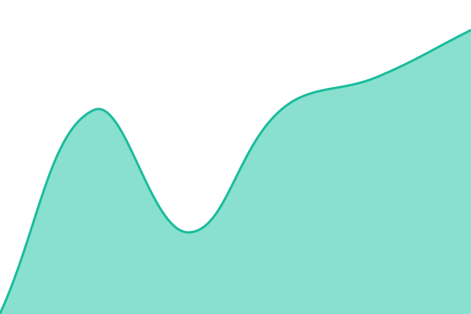

# OrgChain Status

Public availability and incident history: https://status.orgchain.tech/

<!--start: status pages-->
<!-- This summary is generated by Upptime (https://github.com/upptime/upptime) -->
<!-- Do not edit this manually, your changes will be overwritten -->
<!-- prettier-ignore -->
| URL | Status | History | Response Time | Uptime |
| --- | ------ | ------- | ------------- | ------ |
|  [Website](https://orgchain.tech/) | 🟩 Up | [website.yml](https://github.com/chals1029/orgchain-status/commits/HEAD/history/website.yml) | 

 639ms
     
 | 

<a href="https://status.orgchain.tech/history/website">100.00%</a>
    

|  [Application health](https://orgchain.tech/up) | 🟩 Up | [application-health.yml](https://github.com/chals1029/orgchain-status/commits/HEAD/history/application-health.yml) | 

 410ms
     
 | 

<a href="https://status.orgchain.tech/history/application-health">100.00%</a>
    

<!--end: status pages-->

Monitoring runs on GitHub Actions, independently of the OrgChain VPS. Scheduled checks can be delayed. These checks do not test sign-in, email delivery or private submissions.

Maintenance: create an issue with the `maintenance` label and Upptime start/end metadata. Never include student records, document contents, internal addresses or credentials in issues.
